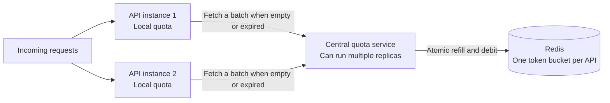

# Distributed rate limiting

Java 21 / Spring Boot service for shared, per-API rate limits. Multiple service instances fetch small token batches from a central quota service, then check each incoming request against their local quota. Redis owns the global token bucket and performs atomic allocation with Lua.

## Architecture



| Module | Responsibility |
| --- | --- |
| `rate-limit-core` | Validated policy, quota request and grant records |
| `rate-limit-client` | Reusable HTTP client and thread-safe local limiter; no Spring dependency |
| `quota-service` | Policy management, authentication, algorithm registry and Redis allocation |
| `demo-service` | Orders and payments APIs, deployed as two instances in Compose |

An API ID identifies a shared logical operation, such as `orders` or `payments`. Every instance serving the same API uses the same ID. Limits apply to the whole API, across instances; these are not separate per-user limits. Map an ID to a specific HTTP method and route in your application if those operations need separate quotas.

## Run the demo

Requires Docker with Compose. Credentials in `.env.example` are for local use; use separate random values for a deployment.

```sh
cp .env.example .env
docker compose up --build -d
```

Wait until `http://localhost:8080/actuator/health/readiness` returns `UP`, then register both API policies. Load your local credentials into the shell:

```sh
set -a
. ./.env
set +a

curl --fail-with-body -X PUT http://localhost:8080/v1/apis/orders \
  -H "Authorization: Bearer $QUOTA_ADMIN_TOKEN" \
  -H 'Content-Type: application/json' \
  -d '{"algorithm":"token_bucket","capacity":20,"refillTokensPerSecond":2,"maxBatchSize":5,"leaseTtlMillis":1000}'

curl --fail-with-body -X PUT http://localhost:8080/v1/apis/payments \
  -H "Authorization: Bearer $QUOTA_ADMIN_TOKEN" \
  -H 'Content-Type: application/json' \
  -d '{"algorithm":"token_bucket","capacity":10,"refillTokensPerSecond":1,"maxBatchSize":5,"leaseTtlMillis":1000}'
```

Send requests to both instances. They share the orders bucket; payments has its own bucket.

```sh
curl -i http://localhost:8081/api/orders
curl -i http://localhost:8082/api/orders
curl -i http://localhost:8081/api/payments

# Alternate requests between two instances to exhaust the shared orders quota.
for i in $(seq 1 50); do
  port=$((8081 + i % 2))
  curl -s -o /dev/null -w '%{http_code}\n' "http://localhost:$port/api/orders"
done
```

The demo returns `200` when admitted, `429` when quota is exhausted, and `503` when fresh quota cannot be obtained. Denials include `Retry-After` in whole seconds. `X-Service-Instance` identifies the serving instance; `X-Local-Quota-Remaining` reports that instance's cache, not globally remaining quota.

Stop with `docker compose down`. Redis data survives because it uses a named volume. For a deliberate clean reset of local demo policies and balances, use `docker compose down -v`.

## Central quota API

| Method and path | Credential | Behavior |
| --- | --- | --- |
| `PUT /v1/apis/{apiId}` | Admin token | Create or update an API policy |
| `GET /v1/apis/{apiId}` | Admin token | Read the configured policy |
| `POST /v1/apis/{apiId}/quota` | Service or admin token | Atomically reserve a token batch |
| `GET /actuator/health/liveness` | None | Check process liveness |
| `GET /actuator/health/readiness` | None | Check readiness including Redis |

Policy fields:

| Field | Meaning |
| --- | --- |
| `algorithm` | `token_bucket`; additional registered strategies can be added |
| `capacity` | Maximum central balance and initial burst allowance (1–1,000,000) |
| `refillTokensPerSecond` | Continuous refill rate (0.001–1,000,000); fractional balances are retained |
| `maxBatchSize` | Maximum tokens in a grant (1–capacity) |
| `leaseTtlMillis` | Local grant lifetime (50–30,000 ms) |

Quota request:

```json
{"requestedTokens":5,"minimumTokens":1}
```

Example successful response:

```json
{"grantedTokens":5,"centralRemainingTokens":15,"retryAfterMillis":0,"leaseTtlMillis":1000}
```

A partial grant is allowed if it satisfies `minimumTokens`. Otherwise nothing is debited and the service returns HTTP `200` with `grantedTokens: 0` and a positive `retryAfterMillis`. This is a quota decision, not a transport error; the protected application turns it into `429`. `minimumTokens` supports requests costing more than one token and must not exceed the policy's `maxBatchSize`. The service clamps `requestedTokens` to that maximum.

Unknown APIs return `404`; invalid IDs, policies, requests and unknown algorithms return `400`; missing credentials return `401`; insufficient permissions return `403`; Redis failures return `503`. IDs are 1–128 letters, digits, underscores, dots or hyphens, beginning with a letter or digit. All record fields are required; unknown JSON fields are rejected.

Updating an existing policy first refills with its old rate, then preserves its balance and clamps it to the new capacity. Repeated policy updates do not mint a fresh bucket. Existing local leases remain usable until their original expiry. Changing an existing API's algorithm requires an explicit migration; the built-in strategy rejects in-place algorithm changes with `409`.

## Use the Java client

Build and install the modules with `mvn install` while Redis is available. Add `io.github.nautiyalanuj:rate-limit-client:1.0.0-SNAPSHOT` to your service. Create one limiter per API per process and reuse it across requests:

```java
var quotaClient = new HttpQuotaClient(
    URI.create("http://localhost:8080"),
    System.getenv("QUOTA_SERVICE_TOKEN"),
    Duration.ofMillis(500));
var ordersLimiter = new LocalRateLimiter("orders", 5, quotaClient);

LimitDecision decision = ordersLimiter.tryAcquire();
// Or ordersLimiter.tryAcquire(2) for an operation costing two tokens.
switch (decision.status()) {
    case ALLOWED -> processRequest();
    case RATE_LIMITED -> respondTooManyRequests(decision.retryAfterMillis());
    case QUOTA_UNAVAILABLE -> respondServiceUnavailable();
}
// Close quotaClient during application shutdown.
```

Client batch size controls the desired reservation; the central policy imposes the maximum. Keep the client batch size at or below `maxBatchSize` if using weighted costs. A cost must be between 1 and the client batch size. `QuotaClient` is an interface so transports or test doubles can be substituted.

Local tokens never refill independently. The limiter fetches only when it cannot cover a request or its lease has expired. A synchronized critical section prevents concurrent double consumption and permits only one fetch in flight per limiter. Negative decisions are cached until the retry time, and transport failures trigger a short 100 ms backoff. Existing valid cached tokens can still be spent during an outage; requests needing fresh quota fail closed.

The client uses a monotonic clock and subtracts the entire fetch round trip from the lease lifetime. A lease that expires in transit is discarded. Mutating HTTP quota requests are not automatically retried: an ambiguous timeout can have debited Redis already, and retrying could reserve twice. A later fresh fetch may proceed after backoff; lost grants remain spent.

## Quota semantics and tradeoffs

Redis grants obey the token-bucket envelope: starting from a full bucket, grants over a duration `t` cannot exceed `capacity + refillRate * t`. Lua uses Redis server time, not the clock of each quota-service replica, and serializes refill, validation and debit. The policy and mutable balance share one Redis hash (`drl:{apiId}:bucket`), preventing a policy-update race within an allocation. Fractional balances survive repeated checks. The script executor reloads scripts automatically if Redis loses its script cache.

Batching moves admission checks off the central service, but admission time differs from reservation time. Cached leases can combine with freshly refilled tokens to produce a larger instantaneous request burst than the central capacity. With `N` limiter processes, batch maximum `B` and central capacity `C`, `C + N * B` is a conservative bound for that burst; expiry further limits how long quota can be held. Use small batches and short leases for tighter behavior. Use batch size `1` to check central quota for each request.

Unused quota is not returned on expiry or instance shutdown: it was already debited, so returning it after a refill could create extra capacity. An idle or crashed instance can therefore strand a small batch until refill restores capacity. A residual batch smaller than a weighted request is also discarded before fetching. There is no fairness guarantee between instances; busy instances can acquire a larger share. Rate limiting is for admission, not concurrency control.

The storage must retain bucket state. Policies and balances deliberately have no key TTL. Eviction or deletion removes the policy and causes fresh fetches to fail until reconfigured; recreating the policy starts a fresh bucket. Compose uses AOF persistence and `noeviction`. Redis failover to a replica missing acknowledged writes can restore spent quota; deployments requiring stronger guarantees need an appropriate Redis durability/failover design. Put Redis on a private network with ACLs/TLS, supply distinct tokens, use HTTPS for quota traffic, and restrict health endpoints at the deployment edge. The local Compose ports bind to loopback.

## Add another algorithm

Implement `RateLimitAlgorithm` as a Spring bean with a unique `name()`. The service discovers implementations and dispatches using the policy's `algorithm` field. The strategy owns atomic configuration and allocation, stores its canonical policy in the per-API hash's `policy` field, and returns the existing `QuotaGrant` contract. The token-bucket implementation and Lua scripts provide an example. Extend `ApiPolicy` if a new strategy needs additional configuration fields.

Algorithms must support quota reservations to work with local batching. For a sliding-window or fixed-window implementation, ensure leases cannot be spent outside the window they belong to. Implement an explicit migration procedure before switching an existing API between strategies.

## Build and test

Requires JDK 21, Maven 3.8+ and Redis 7.4. Start just Redis with the demo environment configured:

```sh
cp .env.example .env # if not already present
docker compose up -d redis
mvn -B verify
```

To test against a dedicated Redis endpoint:

```sh
TEST_REDIS_HOST=localhost TEST_REDIS_PORT=16379 mvn -B verify
```

The tests use real Redis for concurrent allocation across independent central allocators, eight application limiters over HTTP, independent API quotas, partial and weighted grants, fractional refill, balance-preserving policy changes, and credential permissions. Unit tests cover local concurrency, lease expiry, network latency, outage backoff, invalid inputs and malformed HTTP responses. Tests use unique API IDs and delete only their own keys. GitHub Actions starts Redis and runs the full Maven verification. Redis must be available; integration tests are not silently skipped.

For a local JVM deployment, package with `mvn package` and run the JARs:

```sh
export QUOTA_ADMIN_TOKEN=local-demo-admin-token-change-me
export QUOTA_SERVICE_TOKEN=local-demo-service-token-change-me
java -jar quota-service/target/quota-service-1.0.0-SNAPSHOT.jar
# In separate terminals, retaining the same service token:
PORT=8081 INSTANCE_ID=demo-1 java -jar demo-service/target/demo-service-1.0.0-SNAPSHOT.jar
PORT=8082 INSTANCE_ID=demo-2 java -jar demo-service/target/demo-service-1.0.0-SNAPSHOT.jar
```

Quota-service configuration: `PORT`, `REDIS_HOST`, `REDIS_PORT`, optional `REDIS_PASSWORD`, `REDIS_TIMEOUT` (default `500ms`), `REDIS_CONNECT_TIMEOUT` (default `1s`), required distinct `QUOTA_ADMIN_TOKEN` and `QUOTA_SERVICE_TOKEN` (at least 16 characters). Demo configuration: `PORT`, `INSTANCE_ID`, `QUOTA_URL`, `QUOTA_SERVICE_TOKEN`, `QUOTA_BATCH_SIZE`, `QUOTA_TIMEOUT_MILLIS` (default `500`, maximum `30000`). Set timeouts and lease lifetimes to suit deployment latency; slow or cold connections can lose reserved batches if a timeout occurs. Micrometer counters track `quota.granted.tokens`, `quota.denied.fetches` and demo `api.requests`; only health is exposed over HTTP by default.

References: [Redis atomic Lua scripting](https://redis.io/docs/latest/develop/programmability/eval-intro/), [Redis server time](https://redis.io/docs/latest/commands/time/), and [Spring Data Redis script execution](https://docs.spring.io/spring-data/redis/reference/redis/scripting.html).
